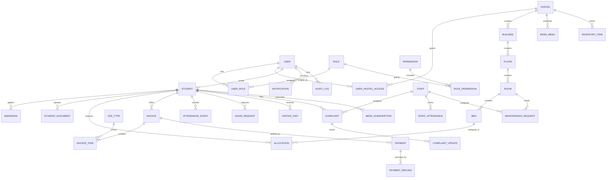

# Private Hostel / PG Management System

## Current application audit

The project already has a working React/Vite client, Express API, PostgreSQL database, JWT authentication, bcrypt password hashing, and admin/student dashboards. The database currently represents one hostel with rooms and room allocations. Existing workflows include resident records, room assignment, payments, attendance, complaints, outpasses, announcements, staff, stock, mess menu, and summary reports.

Important gaps against the master brief:

- Authentication has only `admin` and `student` roles; permissions and per-hostel access are not modeled.
- Rooms are not grouped by hostels, buildings, floors, or individual beds.
- Student admission data and documents are limited; guardian records and verification are absent.
- Current payments are standalone records rather than invoices with line items, balances, refunds, or deposits.
- Outpass records do not cover approval/return history, and visitor logs are absent.
- Complaints lack assignment, priority, updates, and attachment history.
- Staff, inventory, attendance, and reports have basic first versions but need hostel scope, history, and more complete workflows.
- Audit logs, notifications, expenses, backups, API pagination, and security controls need implementation.

The current PostgreSQL data must be migrated additively. Existing demo residents, room assignments, payments, and credentials are retained during schema transitions.

## Target architecture

Keep the existing stack because it is already installed, runs locally without paid services, and is appropriate for this project size:

- **Client:** React, Vite, React Router, Axios, responsive CSS.
- **API:** Express REST modules with route, controller, validation, and authorization layers.
- **Database:** PostgreSQL with versioned, additive SQL migrations and transaction-safe writes.
- **Authentication:** bcrypt password hashes, short-lived signed access tokens, and server-side role/hostel authorization.
- **Files:** private local document storage for local development, served only through authenticated API endpoints. Storage stays behind an interface so deployments can use private object storage later.
- **Exports:** CSV generated locally; PDF/XLSX generation can use open-source libraries after the underlying reports are stable.

All business records that belong to a hostel carry a `hostel_id` directly or through a parent relation. The API derives accessible hostel IDs from the authenticated account and rejects requests outside that set. UI filtering is not considered authorization.

## Core database relationship model

Key integrity rules:

- A bed has at most one current allocation, enforced by a partial unique index on active allocations.
- A student has at most one active bed allocation unless an explicit future business rule permits otherwise.
- Room capacity is the count of active beds; occupancy is the count of active allocations, not a separately trusted counter.
- Room numbers are unique within a floor; bed numbers are unique within a room.
- Invoice, payment, refund, allocation, check-out, and transfer changes use database transactions and preserve history.
- Money uses `NUMERIC(12,2)` and payment records cannot exceed an invoice balance without a recorded credit/refund rule.
- Documents are private metadata rows; public static hosting never exposes identity files.

## Implementation sequence

### Phase 1 — Foundation and authorization

1. Add versioned database migrations and schema documentation.
2. Introduce users, roles, permissions, role-permission mappings, hostel access, login history, failed-login tracking, and audit events.
3. Migrate current admin and student credentials into the shared user identity while preserving existing login behavior.
4. Add API validation, request IDs, consistent errors, login rate limits, token expiry, password change/reset, and authorization tests.

### Phase 2 — Multi-hostel geography and admissions

1. Add hostels, buildings, floors, rooms, beds, student admission profiles, guardians, admissions, and private document metadata.
2. Create one default hostel/building/floor for existing rooms and derive bed rows from current room capacity.
3. Move allocations onto beds while retaining allocation history and existing dashboard behavior.
4. Add search, filters, and server-side pagination to resident and room lists.

### Phase 3 — Fees, rent, and account statements

1. Add fee categories, invoices, invoice lines, monthly billing schedules, deposits, payments, and refunds.
2. Migrate existing payment rows into payment history without marking invoices settled unless there is a corresponding payment.
3. Add partial payment and balance calculations, transaction IDs, receipts, and financial reports.

### Phase 4 — Daily operations

1. Extend attendance into auditable check-in/check-out events and authorized corrections.
2. Add leave approval/return tracking, overdue-return alerts, visitor registration/logs, and complaint assignment/update history.
3. Scope mess menus, subscriptions, meal attendance, and expenses to hostels.

### Phase 5 — Staff, inventory, maintenance, and notifications

1. Add hostel-scoped staff profiles, staff attendance, duties, and role assignment.
2. Extend stock records with purchases, condition, room assignment, and maintenance lifecycle.
3. Add in-app notifications, system settings, and alert rules.

### Phase 6 — Dashboards and exports

1. Build role-relevant dashboards from real aggregate queries.
2. Add occupancy, revenue, collection, admissions, attendance, leave, visitor, complaint, stock, and maintenance reports.
3. Add CSV first, then PDF/XLSX exports with verified totals.

### Phase 7 — Quality, deployment, and documentation

1. Test authorization boundaries, cross-hostel access, allocation concurrency, billing arithmetic, upload limits, and core workflows.
2. Add backup/restore instructions and operational health checks.
3. Document installation, migration, demo accounts, role workflows, API routes, and local deployment.

## Working rules

- Implement incrementally; keep current routes usable during migrations.
- Prefer additive migrations and backfills over table replacement.
- Keep demo data synthetic and label it as demonstration data.
- Do not claim a role or workflow is complete until both UI and API enforce it.
- The brief targets 500–1000 residents; use indexed, paginated queries and test realistic data volumes before making performance claims.

## Status

- Existing single-hostel workflows audited; the plan and relationship diagram are documented.
- Shared `app_user` identities, seeded role-permission mappings, login attempt/lockout tracking, password reset transactions, and active-account checks are implemented.
- Two demo branches are available: Main Hostel and Garden Annex. Buildings, floors, rooms, beds, and user-to-hostel access are modeled with additive migrations.
- Existing residents, payments, room assignments, operations data, and demo credentials are retained and assigned to Main Hostel.
- Resident, room, payment, complaint, leave, attendance, staff, inventory, menu, announcements, and summary queries are branch-scoped in the API.
- Bed-level room allocation is transactional and selects a free bed under a row lock.
- Allocation history now preserves transfer and checkout timestamps, releases beds, recalculates room occupancy transactionally, and returns a checkout fee/deposit summary.
- Branch and team administration screens, resident search and pagination, and a leave request approval/departure/return queue are implemented.
- Admission review with guardian details, private document upload/download, visitor check-in/out, maintenance work orders, complaint update history, and stored notifications for admission, complaint, maintenance, and announcements are implemented.
- Uploaded admission documents have branch-scoped pending/verified/rejected states with an audit record and review controls.
- Fee categories/rates, recurring monthly invoices, invoice balances, payment receipts, partial/full refund records, and resident invoice views are implemented.
- Finance staff can create one-off invoices (including security deposits), print receipts to PDF from the browser, and see outstanding-fee/refundable-deposit figures during checkout.
- Parent accounts can be linked by the guardian email captured on admission. The family portal shows linked residents, attendance, invoices, announcements, and leave departure/return history.
- Meal plans can be started, paused, resumed, or ended; meal attendance requires an active plan and rejects duplicate check-ins. Staff attendance is recorded by day, and branch-scoped hostel expenses feed the current-month expense summary.
- A database-backed health endpoint, example environment file, and PostgreSQL/private-document backup and deployment instructions are available.
- Remaining scope includes applicant self-service, richer report filters and exports, QR attendance, executing the returned deposit settlement amounts as a formal checkout workflow, and broader concurrency/security testing. The system remains a phased build rather than claiming every master-brief item is complete.
